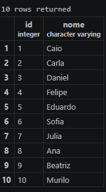
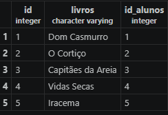
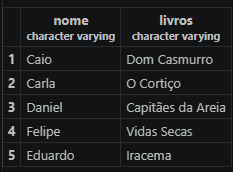
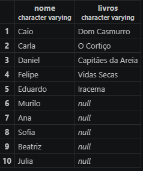
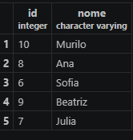

# Atividade prática 11

### Relacionamento entre tabelas

- Foto das duas tabelas:



- Foto usando INNER JOIN:

RESPOSTA: Os alunos que não apareceram foram Sofia, Julia, Ana, Beatriz, Murilo, eles não apareceram porque não emprestaram nenhum livro.

- Foto usando LEFT JOIN:

RESPOSTA: Para quem nunca pegou um livro aparece `null` de nulo.

- A bibliotecária quer saber quem NUNCA pegou livro:

```sql
SELECT a.id, a.nome FROM alunos a WHERE NOT EXISTS ( 
    SELECT 1
    FROM emprestimos e
    WHERE e.id_alunos = a.id
);
```
- Tente registrar um empréstimo para o aluno 50:
   INSERT INTO emprestimos (livro, id_aluno) VALUES ('Turma da Mônica', 50);
Responda: o que aconteceu? Por quê?

RESPOSTA: O PostgreSQL não inseriu o empréstimo, ele cancelou o comando porque o aluno de id = 50 não existe na tabela alunos